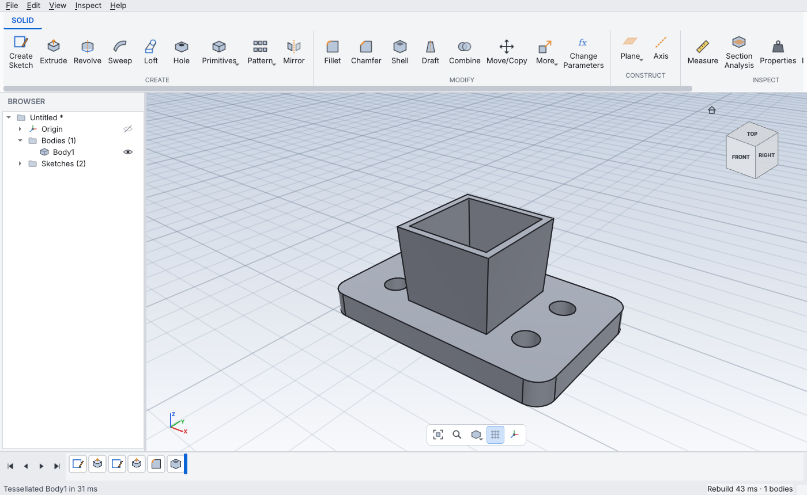

# Fission360

A parametric, history-based 3D CAD modeller for Linux/Ubuntu, modelled on the
workflow of Autodesk Fusion 360: sketch → constrain/dimension → features →
editable timeline, driven by named parameters.



## Install & run (Ubuntu 22.04 / 24.04)

```bash
git clone https://github.com/cannabinator/fission360 && cd fission360
./scripts/install.sh      # venv in ~/.local/share/fission360, app-menu entry, .f3x MIME type
fission360                # or: fission360 part.f3x
```

For development: `./scripts/run-dev.sh` (creates `.venv`, editable install).
Tests: `pytest` (UI smoke test runs when a display is available, e.g. `xvfb-run -a pytest`).

### Remote access from Windows (browser or VNC, for testing)

`scripts/remote.sh` runs the app on a virtual display (Xvfb, software OpenGL)
and serves it with x11vnc + noVNC. Missing packages are installed via apt.
The app runs fullscreen and restarts automatically if you close it.

**Option A – SSH tunnel (default, nothing exposed to the network)**

On the Linux machine:
```bash
./scripts/remote.sh                 # options: --size 1920x1080  --port 6080  [file.f3x]
```
On Windows 11 (PowerShell, OpenSSH is built in):
```powershell
ssh -L 6080:localhost:6080 -L 5900:localhost:5900 user@linux-host
```
Then open <http://localhost:6080/vnc.html?autoconnect=1&resize=scale> in Edge/Chrome,
or connect a VNC client (TightVNC, RealVNC) to `localhost:5900`.

**Option B – direct on a trusted LAN**
```bash
./scripts/remote.sh --public        # prints URL + generated VNC password
```
Open `http://<linux-ip>:6080/vnc.html` from Windows. VNC traffic isn't encrypted,
so use option A on any network you don't fully trust.

Tips: in the browser, middle-drag pans and Shift + middle-drag orbits as usual. If your
mouse lacks a middle button, use right-drag (orbit) and the navigation bar. The noVNC side
panel has clipboard and fullscreen buttons.

Requirements: Python ≥ 3.10 and an OpenGL 3.3 driver (any Mesa/NVIDIA/AMD/Intel driver of the last decade).

## Features

**Modelling workflow (Fusion-style)**
- Parametric **timeline** with rollback marker, drag-to-reorder, suppress, edit, delete; failing features turn red with the reason.
- **Parameters** dialog: user parameters + auto-created model parameters (`d1`, `d2`…), unit-aware expressions (`width/2 + 3 mm`, `30 deg`, `sqrt()`, `sin()`…), dependency tracking, cycle detection, rename-refactoring.
- Live **preview** for every command; the panel is generated from a declarative feature spec.
- Undo/redo for everything (including individual sketch edits), autosave every 2 min, recent files.

**Fusion-style quality of life**
- **Drag handles** in the canvas for extrude distances (one side / symmetric / two sides), offset planes, fillet & chamfer size and shell thickness; snaps to zoom-dependent steps (hold Ctrl for free drag).
- **Press Pull (Q)** and Extrude pick **Join / Cut / New Body automatically** (into material cuts, out of a face joins) until you choose an operation.
- **Type values while sketching**: after the first click of a line, rectangle or circle just type the length/width/diameter (Tab for the next field or to enter expressions like `width/2`); the values become driving dimensions.
- Snapping to points, **line midpoints** (adds a midpoint constraint) and curves, with snap glyphs and dashed horizontal/vertical inference guides.
- **Window / crossing selection**: drag left→right to select fully enclosed items, right→left for anything touched (sketch geometry, bodies, or edges inside the Fillet command).
- Fillet/chamfer: pick a **face to round all its edges**; **tangent chain** follows smooth edge loops.
- Value boxes step with **Up/Down or the mouse wheel** (Shift ×0.1, Ctrl ×10) and show the evaluated value in their tooltip; Enter = OK.
- ViewCube: **26 views** (faces, edges, corners) and **drag the cube to orbit**; **Look At** a selected face; **F6 fits the selection**.
- Hovering a timeline feature highlights the bodies it created or changed; the status bar names what's under the cursor; inline rename (F2) in the browser; sketch palette toggles for dimensions, constraints and profiles; expression-driven dimensions show as `fx: …`.

**Assemblies and drawings (roadmap phase 2)**

- **Joints** (Assemble ▸ Joint, `J`): mate a face of the moving part to a face of the fixed part. Planar faces mate face-to-face; cylindrical faces align axes. Motion types: rigid, revolute (angle), slider (travel), cylindrical (both). Offset and angle are parametric. The joint is a timeline feature, so it rebuilds and can be edited like any other.
- **Components**: right-click a body ▸ *Set Component...*. Bodies in one component move together under a joint, show grouped in the browser, and export to STEP as a real assembly tree (part names preserved).
- **Drawings** (File ▸ Export Drawing): front/top/right/iso views with exact hidden-line removal (hidden edges hidden behind visible ones are not doubled), automatic standard scale, overall dimensions and a title block, as SVG or layered DXF. Script: `design.drawing("part.svg", views=("front", "top", "right"))`.
- **Joint motion**: right-click a joint in the timeline ▸ *Joint Motion / Limits...* for a slider, play/pause animation and min/max limits (angle or travel are clamped, with a warning). Script: `design.joint(..., limits=(-45, 60))`, `design.animate(joint, [0, 30, 60])`.
- **Drawing extras**: section view A-A with 45° hatching (`views=(..., "section")`), centre marks, centre lines and Ø callouts for holes and bosses.
- **Placed dimensions and parts list**: `design.drawing(path, dims=[{"view": "front", "p1": (0,0,0), "p2": (25,0,0), "kind": "horizontal"}], bom=True)` adds horizontal/vertical/aligned dimensions with extension lines (optional text override, e.g. tolerances) and a BOM table (components merged, mass from each body's material).
- **Sheet metal (phase 3, first slice)**: *Flange* bends a wall from a sheet's thin edge face (height, angle, inside radius, K-factor, bend direction) and records the bend. *Flat Pattern (DXF)* unfolds the body analytically (developed length = bend allowance `angle*(R+K*t)` + height) into CUT and BEND layers, holes included. Script: `design.flange(face, "15 mm", "90 deg", "3 mm")`, `design.flat_pattern("part.dxf")`. Current limits: flanges attach to the base sheet only (no flange-on-flange), no corner reliefs, no hems/jogs.
- Script: `design.component("Lid", body)`, `design.joint(moving_face, fixed_face, kind="revolute", angle="30 deg")`.

**Roadmap implementation (from the competitive analysis in `reports/`)**
- *Robustness layer*: booleans retry with looser tolerances and shape healing; Fillet, Chamfer and Shell **explain failures and name the largest value that works** ("largest radius that works is about 14.9 mm"); features that lose a face/edge/profile are flagged "reference lost" in the timeline, and editing them lists what must be re-selected.
- *Diffable files*: `.f3x` is plain sorted, indented JSON (Git-friendly, atomic writes; gzip still loads); **named versions** with a feature-level diff and one-click restore (File > Version History).
- *Sketch*: **text** (any installed font; letter counters become real holes), **ellipse**, **offset**, **mirror** (keeps symmetry constraints), **rectangular & circular patterns**, **extend**, **insert DXF / SVG** (lines, arcs, circles, polylines, splines, paths, units and transforms) and **export DXF**.
- *Features*: **variable-radius fillet**, **Rib / Web**, **cosmetic threads** (ISO metric + UNC/UNF tables, internal/external detection, label in the canvas) and **tapped holes** (drilled to tap-drill size). Text + Extrude gives emboss/engrave automatically.
- *Export*: **3MF** for slicers (welded mesh, millimetres).
- *Selection*: **Select Other** (Tools menu / marking menu) lists every face along the ray under the cursor, including hidden ones.
- *Scripting*: `fission360.api` drives the same document the GUI edits (parameters, sketches, features, geometry selectors); run with `fission360 --run script.py` (headless, CI friendly) or Tools > Run Script. See `examples/bracket.py`.

**Sketching**
- Line (chained), 2-point & center rectangle, circle, 3-point & center arc, polygon, slot, spline, point.
- Snapping to points/curves, horizontal/vertical inference, optional grid snap; auto-coincident constraints.
- Constraints: coincident, point-on-curve, horizontal, vertical, parallel, perpendicular, collinear, tangent, equal, concentric, midpoint, symmetry, fix.
- Smart dimension tool (length, distance, horizontal/vertical distance, radius, diameter, angle); dimensions accept expressions; over-constraining dimensions become driven (reference) dimensions.
- Live DOF count, fully-constrained geometry turns black (blue = free), direct dragging of geometry, trim, sketch fillet, construction geometry, project body edges.
- Sketch on origin planes, construction planes or any planar face. Profiles (closed regions, including nested ones) are detected automatically and shaded.

**Solid features**: extrude (one side / symmetric / two sides, taper, new body / join / cut / intersect), revolve, sweep, loft, hole (simple / counterbore / countersink), fillet, chamfer, shell, draft, box / cylinder / sphere / torus / coil, rectangular & circular pattern, mirror, combine, move/copy, scale, split body, remove, offset plane, plane at angle, construction axis.

**Inspect**: measure (distance, angle, length, area, radius), section analysis, mass properties per material, interference check.

**Data exchange**: STEP (AP214), IGES, STL, OBJ, BREP export; STEP, IGES, STL, BREP import. Native format `.f3x` (gzipped JSON, versioned).

**UI**: ribbon toolbar, browser tree (origin, bodies, sketches, construction; visibility, rename, appearance, material, isolate), ViewCube with animated views, navigation bar, visual styles, **S** command search, right-click **marking menu**, light/dark themes.

### Mouse & keys
| Action | Input |
|---|---|
| Orbit | Shift + middle drag, right drag, Alt + left drag (pivots on geometry under the cursor) |
| Pan | Middle drag |
| Zoom | Wheel (zooms about the cursor) |
| Fit | F6 / double-click middle |
| Commands | S search · E extrude · Q press pull · F fillet · H hole · M move · I measure · F6 fit selection · Del delete |
| Select | Click · Shift/Ctrl+click add · drag left→right window · right→left crossing |
| Sketch | L line · R rectangle · C circle · A arc · D dimension · T trim · P project · X construction · Esc cancel · type numbers while drawing, Tab = next field |

## Architecture & technical decisions

```
fission360/
  core/expressions.py   safe AST evaluator with units (no eval) → documents can't run code
  core/parameters.py    parameter table, dependencies, cycle detection
  core/kernel.py        the only module touching OpenCASCADE (OCP bindings)
  core/references.py    persistent face/edge/profile references (topological naming)
  core/features.py      declarative feature specs + rebuild executors
  core/document.py      timeline, incremental rebuild, undo/redo, persistence
  sketch/solver.py      numeric constraint solver
  sketch/model.py       sketch entities, constraints, dimensions
  ui/                   Qt 6 widgets, OpenGL renderer, tools, panels
```

- **Kernel: OpenCASCADE (OCCT)**, the only production-grade open B-rep kernel, via the `cadquery-ocp` wheels (no compiling). Booleans run parallel with fuzzy tolerance and results are cleaned with `UnifySameDomain` so faces split by booleans merge back. Profile detection uses OCCT's General Fuse on a bounding face, which yields Fusion-like region selection for overlapping/nested curves.
- **Incremental rebuild**: every feature has a cumulative fingerprint (its definition + the values of the parameters it uses + everything before it). Only features after the first changed one are recomputed; earlier model states are reused (B-rep handles are immutable, so caching is cheap). Typical parameter changes rebuild in tens of milliseconds.
- **Topological naming**: references store geometric signatures (type, centre, normal/tangent, size) and re-resolve by best match scaled by body size, so fillets/shells/sketch-on-face survive dimension changes. Profiles are referenced by an interior point, the same approach Fusion uses.
- **Constraint solver**: damped Gauss–Newton with *minimum-norm* SVD steps; geometry not pinned by constraints moves as little as possible, which makes dragging feel natural. Dragged points are column-weighted so they stick to the cursor. DOF and per-entity "fully constrained" state come from the Jacobian null space; redundant/conflicting constraints are rejected.
- **Rendering**: OpenGL 3.3 core profile. One VAO per body uploaded on geometry change only; Blinn-Phong key/fill/rim lighting; geometry-shader thick anti-aliased lines (core profile has no wide lines); MSAA; integer-ID picking buffer read in a small window around the cursor with priority vertex > edge > face, so thin edges are easy to hit; clip plane for section analysis; tessellation deflection adapts to model size.
- **UI**: Qt 6 (PySide6) — native on X11 and Wayland, HiDPI aware. Feature dialogs are generated from specs, so adding a feature is a spec entry + one executor function.

## Scope & roadmap

Implemented from the roadmap: Phase 0 (robustness, diffable format) and Phase 1 (sketch tools, DXF/SVG, 3MF, threads, rib, variable fillet) plus from Phase 2 the scripting API and file versioning. Plus the first slice of Phase 2: joints, components with assembly STEP export, and 2D drawings. **Not yet implemented**: sheet-metal reliefs/hems/flange chains, as-built joints and contact/collision during motion, a GUI for placing drawing dimensions, detail views, full-round fillet, modeled (helical) threads, canvas images, thicken/stitch/surface tools, direct-edit face tools, sheet metal, CAM, simulation, rendering, T-splines. See `reports/Fission360 competitive gap analysis.md` for the full prioritised plan.

